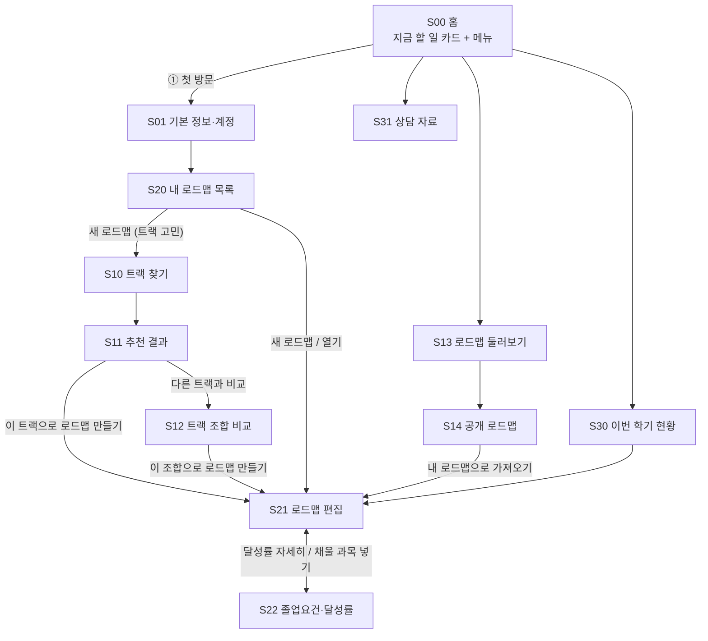

# 화면 구성 (v2 — 진로로드맵 중심)

> 기준일 2026-11-25 · 결정: 임솔(기획)
> v1(2026-11-22, 졸업요건 검사 중심)을 공모전 OT 요구(`docs/OT_REQUIREMENTS.md`)에 맞춰 다시 짰다. 차이와 이유는 `docs/OT_GAP.md`, 결정은 `docs/DECISIONS.md` 2026-11-25 행.
> 이 문서는 화면이 **무엇을 보여 주고 무엇을 하게 할지**만 정한다. 색·크기 같은 디자인과 코드는 각 작업지시서에서 정한다.

---

## 1. 원칙

### 1-1. 중심은 '학기별 진로로드맵'
OT 1순위는 1~4학년 전 학기 진로로드맵이다. 길잡이의 중심 화면은 **S21 로드맵 편집**이다. 다른 화면은 모두 이 로드맵을 만들고(찾다), 채우고(짜다), 지키는(지키다) 데 쓰인다.

| 묶음 | 하는 일 | OT 항목 |
|---|---|---|
| **찾다** | 진로에서 트랙 조합 찾기, 다른 학생 로드맵 둘러보기 | 2순위 추천, 1순위 (2) 공유 |
| **짜다** | 내 로드맵 만들기·고치기, 졸업요건 달성률 | 1순위 (1) 수립 |
| **지키다** | 이번 학기 현황, 상담 자료 만들기 | 1순위 (3) 실행, (4) 확인 |

### 1-2. 우리 차별점 (v1에서 그대로 유지)
1. **채용공고 기반 트랙 추천**: 적성검사 대신 실제 공고에서 출발한다. AI는 후보 번호만 고른다 (T-009).
2. **근거·출처 표시**: 졸업요건·과목·학점에는 항상 출처 링크와 기준일을 붙인다.
3. **'지금 할 일' 카드**: 조회만 하는 대시보드가 아니라, 지금 상태에서 바로 할 행동을 버튼 하나로 준다.

### 1-3. 그 밖의 원칙
- 학교 규정·과목·학점은 전부 `data/rules` 에서 읽는다. 데이터에 없으면 **"아직 데이터가 없어요"** 라고 표시하고 추측하지 않는다. (AGENTS.md 4-1)
- AI는 '찾다'의 트랙 추천에서만 쓴다. 졸업요건 판정·달성률은 규칙 엔진이 한다.
- **로그인 없이도 로드맵을 끝까지 만들 수 있다** (이 기기에 저장). 공유·다른 기기에서 보기를 할 때만 구글 로그인을 한다. (확정 12)
- 학번·실명·연락처는 받지 않는다. 로그인 이메일은 로그인에만 쓰고 화면·공개 로드맵·관리자 화면·사용 기록·AI 어디에도 보내지 않는다.
- 학교 서비스처럼 익숙한 목록형 홈. 휴대폰 화면(폭 375px)에서도 모든 기능이 되게 한다. 로드맵 편집은 PC에서 가장 편하게, 휴대폰에서도 같은 일을 할 수 있게 한다.
- 화면 문구는 쉬운 말로 쓴다. 학사 용어(전기·전필·전선 등)는 처음 나올 때 풀어 쓴다.

## 2. 확정 사항

### 2026-11-22 (v1, 아직 유효한 것)
| # | 항목 | 결정 |
|---|---|---|
| 1 | 홈 메뉴 | 단계별 묶음(찾다·짜다·지키다) 목록형 |
| 2·3 | 홈 맨 위 | '지금 할 일' 카드 1장: 가장 급한 1개 + 버튼 1개 + "할 일 N개 더" |
| 4 | 할 일 우선순위 | 입력 순서 다음은 졸업 위험 먼저 (4장) |
| 7 | 졸업요건 | 부족한 요건마다 채우는 방법 + 행동 버튼 |
| 9 | 메뉴 이름 | 묶음 제목은 찾다·짜다·지키다, 항목은 쉬운 업무 이름 |
| 10 | 목록에 없는 과목 | '기타 과목'으로 과목명·학점만. 전공 요건에는 세지 않고 총 학점에만 |
| 11 | 홈 메뉴 옆 상태 표시 | 첫 판에 넣는다 |

- v1 확정 5(첫 방문 흐름)·6(이수 입력 화면 따로)·8(지키다 시뮬레이션)은 2026-11-25에 아래 결정으로 바뀌었다.

### 2026-11-25 (v2, OT 반영)
| # | 항목 | 결정 |
|---|---|---|
| 12 | 서버·로그인 | Supabase(DB + 로그인 + 행 단위 권한). 구글 로그인. **로그인 없이 체험** 모드 유지(이 기기 저장) |
| 13 | 구현 범위 | A안: OT 1순위 수립·공유·실행·확인을 모두 넣는다. **수립(S21·S22)은 최소판이 아니라 완성도 높게, 일정도 먼저**. 공유·실행·확인과 2·3순위는 수립이 끝난 뒤 순서대로 |
| 14 | 줄이는 순서 | 12월 말에 밀리면 (3) 실행 → (4) 확인 순서로 단순하게 줄인다 (ROADMAP '줄이는 규칙') |
| 15 | 이수 입력 | 따로 화면을 두지 않는다. 로드맵의 **지난 학기 칸에서 항목을 '완료'로 체크**하면 그것이 이수 내역이다 |
| 16 | 트랙 | 로드맵마다 **1트랙 + 2트랙(미정 가능) + 희망 진로**. 전공 조합별로 로드맵을 여러 개 만들고 대표 1개를 정한다 |
| 17 | 지키다 시뮬레이션 | 트랙 변경 시뮬레이션은 **로드맵 복사 → 2트랙 바꿔 보기 + 트랙 조합 비교(S12)** 로 대신한다. 휴학·조기졸업은 고도화로 |
| 18 | 뺀 것 | 진로 멘토 연락처 목록, 트랙 조합별 커뮤니티(게시판). 이유는 9장 |
| 19 | 졸업 후 5년 계획 | 로드맵을 공개해도 **항상 비공개** |
| 20 | 사용 기록 | **동의한 학생만** 가명 ID로 개인별 사용 흐름(메뉴 이동 순서, 머문 시간)을 모은다. 동의하지 않으면 익명 집계(메뉴별 횟수·시각)만. 실명·학번·이메일은 어떤 경우에도 기록에 넣지 않는다 (8장) |

---

## 3. 화면 목록

| ID | 화면 | 주소 | 묶음 | OT | 작업 |
|---|---|---|---|---|---|
| S00 | 홈 | `/` | — | (3) | T-021 |
| S01 | 기본 정보·계정 | `/me` | 공통 | — | T-022 |
| S02 | 할 일 전체 | `/todo` | 공통 | (3) | T-023 |
| S03 | 트랙 상세 | `/tracks/[track_id]` | 공통 | 2순위 | T-024 |
| S10 | 트랙 찾기 (직무·공고) | `/find` | 찾다 | 2순위 | T-011 |
| S11 | 추천 결과 | `/find/result` | 찾다 | 2순위 | T-011, T-012 |
| S12 | 트랙 조합 비교 | `/find/compare` | 찾다 | 2순위 | T-032 |
| S13 | 다른 학생 로드맵 둘러보기 | `/roadmaps` | 찾다 | (2) | T-029 |
| S14 | 공개 로드맵 보기 | `/roadmaps/[id]` | 찾다 | (2) | T-029 |
| S20 | 내 로드맵 목록 | `/plan` | 짜다 | (1)(2) | T-028 |
| **S21** | **로드맵 편집 (학기별 계획표)** | `/plan/[roadmap_id]` | 짜다 | **(1)** | **T-006, T-027** |
| **S22** | **졸업요건·달성률** | `/plan/[roadmap_id]/check` | 짜다 | **(1)** | **T-008** |
| S30 | 이번 학기 현황 | `/guard` | 지키다 | (3) | T-030 |
| S31 | 상담 자료 만들기 | `/guard/report` | 지키다 | (4) | T-031 |
| S90 | 관리자 대시보드 | `/admin` | 관리자 | 3순위 | T-034 |

- 주소는 T-001의 `/find`, `/plan`, `/guard` 아래에 붙인다. `/admin` 은 관리자 계정만 들어간다.
- v1의 S20(이수 입력)·S30~S33(지키다 시뮬레이션)은 없어졌다. 마이크로디그리 진행률은 S22에 들어간다.

## 4. '지금 할 일' 카드 규칙

위에서부터 검사해서 **처음 걸리는 하나**를 카드에 띄운다. 나머지는 "할 일 N개 더" → S02. 판정은 규칙 엔진 하나(T-020)가 하고, 홈 메뉴 옆 상태 문구도 같은 결과로 만든다. 대상은 **대표 로드맵**이다.

| 순서 | 조건 | 카드 문구 (예) | 버튼 → 화면 |
|---|---|---|---|
| ① | 기본 정보가 없다 | 처음 오셨네요. 입학년도와 지금 학기부터 알려 주세요 (1분) | [시작하기] → S01 |
| ② | 로드맵이 없다 | 희망 진로와 트랙으로 첫 로드맵을 만들어요. 트랙이 고민이면 찾아 드려요 | [로드맵 만들기] → S20 (보조: [트랙 찾기] → S10) |
| ③ | 지난 학기 칸에 '완료' 체크가 하나도 없다 | 지난 학기에 들은 과목을 체크하면 졸업까지 남은 걸 알려 드려요 | [이수 체크하기] → S21 (지난 학기 칸) |
| ④ | 남은 학기에 다 넣어도 못 채우는 요건이 있다 (졸업 위험) | 이대로면 ○○이 △학점 모자라요 | [계획 다시 짜기] → S21 |
| ⑤ | 신청해야 인정되는 제도가 있다 (`needs_application = true` 마이크로디그리를 계획 중) | ○○ 마이크로디그리는 신청해야 인정돼요 | [신청 방법 보기] (출처 링크) |
| ⑥ | 부족한 요건이 있다 (남은 학기로 채울 수 있음) | 전공선택이 6학점 부족해요 | [채울 과목 보기] → S21 (해당 이수구분 필터) |
| ⑦ | 이번 학기 칸에 아직 '완료'가 아닌 항목이 있다 | 이번 학기 계획 5개 중 2개 완료했어요 | [이번 학기 현황] → S30 |
| ⑧ | 비학점 요건을 아직 확인하지 않았다 | 졸업 전에 직접 확인할 항목이 2개 있어요 | [확인하기] → S22 |
| ⑨ | 모두 충족 | 졸업요건을 모두 채웠어요. 졸업 후 계획도 적어 보세요 | [졸업 후 5년 계획] → S21 |

- 카드에는 항상 근거 한 줄을 작게 붙인다. 예: "기준: 2026 졸업요건 (출처 · 2026-11-20 확인)"
- ④는 '한 학기 최대 신청 학점' 데이터가 있어야 판단한다 (T-003 6-2). 없으면 ④는 건너뛰고 "학기당 최대 학점 정보가 없어 졸업 위험은 아직 계산하지 않아요"를 작게 표시한다.
- ⑤는 신청 마감일 데이터가 없으므로 날짜로 급함을 판단하지 않는다.

## 5. 이동 흐름

**첫 방문 학생의 기본 흐름**: 홈 → S01(입학년도·지금 학기, 사용 기록 동의 여부) → S20 [새 로드맵] → 1·2트랙과 희망 진로 고르기(트랙이 고민이면 S10 → S11) → S21에서 지난 학기 완료 체크 → 남은 학기 칸에 항목 배치 → S22로 달성률 확인

- 모든 화면 위쪽에 [홈]과 로그인 상태(로그인 안 함 / 구글 계정 첫 글자)가 있다.

---

## 6. 화면별 내용

각 화면은 **목적 / 보여 줄 것 / 다음 행동 / 비었을 때** 순서로 적는다.

### S00 홈 `/`
- **목적**: 지금 무엇을 해야 하는지 알려 주고, 모든 메뉴로 가는 출발점
- **보여 줄 것**
  1. 제목 "길잡이" + 한 줄 소개
  2. **지금 할 일 카드** (4장)
  3. 메뉴 목록 + 메뉴 옆 상태 표시

     | 묶음 | 메뉴 | 상태 예 | 비었을 때 |
     |---|---|---|---|
     | 찾다 | 희망 직무·채용공고로 트랙 찾기 → S10 | "추천 3개 받음" | (없음) |
     | 찾다 | 트랙 조합 비교 → S12 | (없음) | — |
     | 찾다 | 다른 학생 로드맵 둘러보기 → S13 | "공개 로드맵 128개" | (없음) |
     | 짜다 | 내 로드맵 → S20 | "대표: AI+빅데이터 · 진행률 40%" | "아직 로드맵 없음" |
     | 짜다 | 졸업요건·달성률 → S22 | "2개 부족" / "모두 충족" | "로드맵을 만든 뒤 확인" |
     | 지키다 | 이번 학기 현황 → S30 | "5개 중 2개 완료" | "이번 학기 계획 없음" |
     | 지키다 | 상담 자료 만들기 → S31 | (없음) | — |
  4. 아래쪽 작은 링크: 기본 정보·계정(S01) · 데이터 기준 안내(출처·기준일) · 저장 위치 안내("로그인하지 않으면 이 기기에만 저장돼요")
- **첫 방문**: 홈 아래쪽에 사용 기록 동의 안내 띠를 한 번 띄운다 (8장). [동의하기] [괜찮아요]. 고르기 전까지는 익명 집계만 한다

### S01 기본 정보·계정 `/me`
- **입력**: 입학년도(4자리), 주간·야간, 지금 학년·학기
  - 트랙은 여기서 받지 않고 로드맵마다 정한다 (확정 16)
- **계정**
  - [구글로 로그인] / 로그인 중이면 [로그아웃]
  - 로그인할 때 이 기기에 로드맵이 있으면 "이 기기의 로드맵 N개를 계정에 올릴까요?" [올리기] [나중에]
- **사용 기록 동의** (확정 20): 켜기·끄기 스위치 + "무엇을 모으는지 보기"(8장 문구). 언제든 끌 수 있고, 끄면 [지금까지 모인 내 사용 흐름 지우기]를 함께 보여 준다
- **받지 않는 것**: 학번, 이름, 연락처
- **그 밖**: [이 기기에 저장된 내 정보 모두 지우기] (사용성 테스트용). 로그인 중이면 [내 계정 데이터 모두 지우기]도 둔다

### S02 할 일 전체 `/todo`
- 4장 표 순서대로 해당하는 할 일 전부. 항목마다 문구 1줄 + 버튼 1개 + 근거 1줄
- **비었을 때**: "지금 할 일이 없어요" + [내 로드맵 보기]

### S03 트랙 상세 `/tracks/[track_id]`
- **보여 줄 것** (전부 `data/rules`): 트랙 이름·단과대학·주야간·운영 상태, 전공역량·관련 진로·자격증, 학년·학기별 교육과정 표, 출처·기준일
- **다음 행동**: [이 트랙으로 로드맵 만들기] → S21 (새 로드맵, 1트랙 = 이 트랙) / [다른 트랙과 비교] → S12
- **모집중지 트랙**: "지금은 새로 선택할 수 없는 트랙이에요". 찾다 추천에는 나오지 않는다 (T-009)

### S10 트랙 찾기 `/find` · S11 추천 결과 `/find/result`
- v1과 같다: 직무 탭·공고 탭, 공고 최대 5,000자, 개인정보 안내, AI는 후보 번호만, 이유는 템플릿 + 공고 인용, 출처 표시 (T-009·T-011)
- **바뀐 점**
  - S11의 [이 트랙으로 계획 시작] → **[이 트랙으로 로드맵 만들기]**: 새 로드맵을 만들고 1트랙 = 추천 트랙, 희망 진로 = 입력한 직무로 채워 S21로 간다 (T-012)
  - 추천 트랙 2개 이상을 골라 [비교하기] → S12
  - 고용24 진로적성검사 결과가 있는 학생은 거기서 나온 직무를 직무 탭에 넣으면 된다고 안내한다 (연동은 하지 않음, 1/4 범위 밖)
- 사용 기록에는 공고·직무 입력 내용을 넣지 않는다. "트랙 찾기를 썼다"는 사실만 남긴다

### S12 트랙 조합 비교 `/find/compare`
- **입력**: 1트랙·2트랙 조합을 2~3개 고른다 (운영 중인 트랙만)
- **보여 줄 것 (조합마다 한 열)**
  - 관련 진로·전공역량·자격증 (`competencies.csv`)
  - 커리큘럼: 학년별 과목 수와 대표 과목 (`courses.csv`)
  - 졸업요건: 내 입학년도 기준 전공 필요 학점 (`requirements.csv`)
  - 교육목표: **데이터 필요** (지금 CSV에 없음. 없으면 "아직 데이터가 없어요")
  - 두 트랙 사이 중복 인정: **데이터 필요** (없으면 각 트랙 요건을 따로 보여 준다)
  - 같은 조합 공개 로드맵 수 → S13 (조합 필터)
- **다음 행동**: [이 조합으로 로드맵 만들기] → S21

### S13 다른 학생 로드맵 둘러보기 `/roadmaps`
- **목적**: 나와 비슷한 진로·트랙을 고른 학생의 로드맵을 참고 (익명)
- **필터·검색**: 1·2트랙 조합, 희망 진로 키워드
- **정렬**: 기본은 **많이 가져간 순**, 그다음 최신 순. 센터 추천·우수 졸업생 로드맵은 고도화 때 맨 위 칸으로 넣는다
- **목록 항목**: 희망 진로, 트랙 조합, 학기 수, 가져간 수. 작성자는 "익명"
- **로그인 없이** 둘러보기와 가져오기(이 기기 로드맵으로)가 된다

### S14 공개 로드맵 보기 `/roadmaps/[id]`
- **보여 줄 것**: S21과 같은 학기 칸 배치를 읽기 전용으로. 항목 이름·종류·학기만
- **보여 주지 않는 것**: 완료 여부, 메모, 졸업 후 5년 계획, 작성자 정보 (확정 19)
- **다음 행동**: **[내 로드맵으로 가져오기]** → 내 로드맵 목록에 복사본을 만들고 S21로 (가져간 수 +1)
  - 가져온 뒤 내 입학년도 교육과정에 없는 과목은 '확인 필요' 표시를 붙인다 (데이터와 대조, 지우지는 않음)
- [신고] → 관리자에게 숨기기 요청 (S90)

### S20 내 로드맵 목록 `/plan`
- **보여 줄 것**: 내 로드맵 카드 목록. 카드마다 이름, 1·2트랙, 희망 진로, 진행률, **대표** 표시, **공개** 여부
- **다음 행동**
  - [새 로드맵]: 이름, 1트랙, 2트랙(또는 아직 미정), 희망 진로(직무 이름 한 줄) → S21
  - 카드마다 [열기] [대표로 정하기] [복사하기] [공개하기 / 공개 취소] [지우기]
  - [복사하기]는 "2트랙만 바꿔서 비교해 보기"에 쓴다 (확정 17). 복사 후 트랙을 바꾸면 인정되지 않는 과목에 '확인 필요' 표시
  - [공개하기]는 로그인해야 된다. 누르면 공개되는 것·안 되는 것을 한 번 보여 주고 확인을 받는다
- **비었을 때**: "아직 로드맵이 없어요" + [새 로드맵] + [트랙 찾기]

### S21 로드맵 편집 `/plan/[roadmap_id]` — 핵심 화면 (완성도 우선)
- **목적**: 1~4학년 전 학기에 교과·비교과·학사제도·교외활동을 배치하고, 지난 학기는 완료 체크로 이수 내역을 남긴다
- **화면 구성**
  1. **맨 위 달성률 막대 3개** (규칙 엔진 T-007, 누르면 S22)
     - 졸업학점: 완료 / 계획 포함 / 필요
     - 비교과 포인트: 데이터가 없으면 "비교과 포인트 규정 데이터 준비 중"
     - 로드맵 진행률: 지금 학기까지 계획한 항목 중 완료한 비율
  2. **학기 칸**: 1-1 ~ 4-2 여덟 칸 (PC는 가로 2줄 격자, 휴대폰은 세로 목록). [계절학기 칸 보이기]로 여름·겨울 칸을 켤 수 있다
     - 칸마다: 항목 카드, 학기 학점 합계, 지난 학기 / 이번 학기 / 앞으로 표시
     - 학기 학점이 학기 최대 신청 학점을 넘으면 칸에 경고 (데이터 있을 때만)
  3. **항목 추가 패널** (PC는 오른쪽, 휴대폰은 아래에서 올라오는 창) — T-027
     - 탭 4개: **교과 / 비교과 / 학사제도 / 교외활동**
     - 교과: 내 1·2트랙 교육과정(`courses.csv`), 권장 학년·학기가 맞는 것 먼저. 개설 과목 데이터가 있으면 "이번 학기 개설" 표시. 목록에 없으면 [기타 과목 추가] (과목명·학점, 확정 10)
     - 비교과: 비교과 목록 데이터가 있으면 거기서, 없으면 이름만 직접 입력 (포인트는 데이터가 있을 때만 계산)
     - 학사제도: 마이크로디그리(`micro_degrees.csv`)를 고르면 필요한 과목 묶음이 함께 보인다. 그 밖의 제도(교환학생 등)는 이름 직접 입력
     - 교외활동: 종류(어학시험·자격증·인턴·대외활동·기타) + 이름 + 메모, 직접 입력
     - **요건 필터**: [부족한 것만 보기] → 부족한 이수구분(전필·전선 등) 과목만 보여 준다
  4. **졸업 후 5년 계획** 탭: 연도 칸 5개(졸업 후 1~5년) + 종류 칩(자격증·시험·대학원·취업·이직) + 자유 글. **항상 비공개** (확정 19)
- **조작**
  - **드래그 앤 드롭**: 패널 → 학기 칸, 학기 칸 → 다른 학기 칸, 칸 안에서 순서 바꾸기
  - 드래그 라이브러리는 키보드·터치로도 옮길 수 있는 것을 고른다 (T-006에서 라이브러리 추가 승인)
  - 항목 카드마다 체크박스 = **완료**. 지난·이번 학기 칸에서만 켤 수 있다
  - 항목 카드 메뉴: 빼기, 메모 (교외활동·기타)
  - 같은 과목을 두 번 넣으면 막고 이미 있는 학기를 알려 준다
  - 바꾸면 바로 저장 (로그인 안 함 = 이 기기, 로그인 = 계정). 저장 상태를 작게 표시
- **비었을 때**: 학기 칸마다 "여기로 끌어 놓으세요". 처음 열면 "내 1트랙 권장 과목을 학기 칸에 미리 채울까요?" [채우기] [빈 칸으로 시작]. 채우기는 `courses.csv` 권장 학년·학기 그대로

### S22 졸업요건·달성률 `/plan/[roadmap_id]/check`
- **목적**: 무엇이 부족한지와 어떻게 채우는지 (차별점 2·3의 중심)
- **보여 줄 것**
  - 맨 위 달성률 3개 (S21과 같음)
  - 요건 카드 (`requirements.csv`, 내 입학년도·트랙): 이름, `필요 / 완료 / 계획 포함`, 상태(충족·부족·졸업 위험), 출처·기준일·비고
  - 이수구분별 표: 전기·전필·전선·교양·비교과·기타 과목 학점
  - 1·2트랙이 있으면 트랙별로 나눠 보여 준다. 두 트랙 사이 중복 인정은 데이터가 생기기 전까지 계산하지 않고, 그렇다고 표시한다
  - 마이크로디그리 진행률과 신청 필요 여부
- **다음 행동 (요건마다)**
  - 학점 부족: 안 들은 해당 이수구분 과목 목록 + [로드맵에 넣기] (학기를 고르면 S21에 추가)
  - 교양·비교과 부족: 목록 데이터가 없으면 "○학점 더 필요해요" + 출처 링크
  - 비학점 요건: 조건 문장 + [☐ 달성했어요] + 출처 (자동 판정하지 않음)
  - 졸업 위험: [계획 다시 짜기] → S21
- **데이터가 없을 때**: "내 입학년도의 졸업요건 데이터가 아직 없어요". 다른 해의 요건으로 대신하지 않는다

### S30 이번 학기 현황 `/guard`
- **목적**: 학기 중에 계획대로 하고 있는지 보기 (OT (3))
- **보여 줄 것**: 대표 로드맵의 이번 학기 칸 항목을 종류별(교과·비교과·학사제도·교외활동) 체크리스트로, 완료 비율, 지금 할 일 카드
- **다음 행동**: 체크(완료), [로드맵에서 고치기] → S21
- **줄일 때 (확정 14)**: 이 화면을 빼고 홈 카드 ⑦과 메뉴 상태 표시만 남긴다

### S31 상담 자료 만들기 `/guard/report`
- **목적**: 대표 로드맵 + 이수 현황을 한 장 서식으로 (상담 기초자료, OT (4))
- **보여 줄 것 (A4 한 장 기준)**: 1·2트랙·희망 진로, 학기별 항목 표(완료 표시), 달성률 3개, 부족한 요건, 데이터 기준일·출처
  - 졸업 후 5년 계획은 [5년 계획 넣기]를 켰을 때만 넣는다 (기본 끔)
- **다음 행동**: [인쇄 / PDF로 저장] (브라우저 인쇄 기능)
- **줄일 때 (확정 14)**: 꾸밈 없는 인쇄용 화면 하나만. 포트폴리오 인포그래픽은 고도화

### S90 관리자 대시보드 `/admin` (3순위)
- **들어가는 사람**: 관리자로 등록된 계정만 (T-026)
- **익명 집계 (모든 사용자)**
  - 사용자 수: 일·주별 방문, 로그인 사용자 수, 로드맵 수
  - 메뉴별 사용 횟수와 시간대 (수강신청 기간처럼 언제 많이 쓰는지)
  - 트랙 조합별 로드맵 수, 많이 배치된 과목·비교과·교외활동 상위 목록
  - 공개 로드맵 수, 가져오기 수
- **사용 흐름 분석 (동의한 학생만, 가명 ID)**
  - 많이 나오는 메뉴 이동 경로 (예: 홈 → 트랙 찾기 → 추천 결과 → 로드맵 편집)
  - 화면별 머문 시간 분포, 중간에 그만두는 화면
  - 가명 ID 하나를 골라 그 사람의 이동 순서를 시간 순으로 보기
- **다음 행동**: 각 표 [CSV로 내려받기], 신고된 공개 로드맵 [숨기기]
- **하지 않는 것**: 가명 ID를 계정·이메일과 이어 보기, 비공개 로드맵 원본 열람, 이메일 목록 내보내기
- 추천·우수 로드맵 업로드는 고도화

---

## 7. 저장하는 것

| 저장 항목 | 로그인 안 함 | 로그인 | 공개하면 남에게 보이나 |
|---|---|---|---|
| 기본 정보 (입학년도, 주야간, 지금 학년·학기) | 이 기기 | 계정 | 아니요 |
| 로드맵 목록 (이름, 1·2트랙, 희망 진로, 대표 여부) | 이 기기 | 계정 | 트랙·희망 진로만 |
| 로드맵 항목 (학기, 종류, 과목 코드 또는 이름, 학점, 완료 여부, 메모) | 이 기기 | 계정 | 학기·종류·이름만 |
| 졸업 후 5년 계획 글 | 이 기기 | 계정 | **아니요 (항상)** |
| 비학점 요건 체크 | 이 기기 | 계정 | 아니요 |
| 가져온 수 | — | 서버 집계 | 숫자만 |
| 사용 기록 | 8장 | 8장 | 관리자만 |

- 이메일은 Supabase 로그인 정보에만 있고 앱 테이블에 복사하지 않는다.
- 데이터 형식·테이블·권한(RLS)은 T-004(로드맵 형식, 이 기기 저장)와 T-026(서버)에서 정한다. 둘은 같은 저장소 인터페이스를 쓴다.
- 학번·이름·공고 원문은 저장하지 않는다.

## 8. 사용 기록 (확정 20)

| | 동의 안 함 (기본) | 동의함 |
|---|---|---|
| 모으는 것 | 메뉴(화면) 이름, 시각(시간 단위) | 가명 ID, 화면 이름, 들어온 시각·나간 시각(머문 시간), 직전 화면 |
| 사람과 연결 | 연결하지 않음 (한 줄씩 따로) | **가명 ID**로만 묶음 |
| 로그인 안 한 학생 | 가능 | 가능 (가명 ID를 이 기기에 둠) |

- **가명 ID**: 동의할 때 새로 만드는 무작위 값이다. 로그인 계정 ID·이메일과 같은 값이 아니고, 서버에서 둘을 잇는 표를 두지 않는다. 로그인한 학생이 다른 기기에서도 이어지게 하려고 계정에 가명 ID를 저장해야 하는지는 T-033 지시서에서 다시 본다 (그렇게 하면 관리자 화면에는 여전히 가명 ID만 보이게 한다).
- **넣지 않는 것**: 실명, 학번, 이메일, 공고·직무 입력 내용, 로드맵 항목 내용, 5년 계획 글, 주소의 로드맵 ID.
- **동의 받기**: 첫 방문 안내 띠와 S01 스위치. 기본은 꺼짐이고, 동의하지 않아도 모든 기능을 쓸 수 있다. 문구에 모으는 것·목적(서비스 개선, 센터 활용 분석)·보관 기간·끄는 방법을 쓴다.
- **철회**: S01에서 끄면 바로 수집을 멈춘다. [지금까지 모인 내 사용 흐름 지우기]를 누르면 그 가명 ID 기록을 지운다.
- **결정 필요 (임솔)**: 보관 기간, 동의 문구 최종본. 사용성 테스트 개인정보 동의서와 함께 kyu0lee가 초안을 쓴다.

---

## 9. 데이터 필요

1. **한 학기 최대 신청 학점** (카드 ④, S21 학기 경고). T-003 6-2, kyu0lee 확인 중
2. **학기별 실제 개설 과목** (S21 "이번 학기 개설"). 없으면 권장 학년·학기만 쓴다
3. **비교과 프로그램 목록과 비교과 포인트 규정** (S21 비교과 탭, 달성률). 없으면 이름 직접 입력, 포인트는 "준비 중"
4. **1·2트랙(복수 트랙) 이수 규정**: 두 트랙 사이 중복 인정 등 (S12, S22). 없으면 트랙별로 따로 보여 준다
5. **트랙 교육목표** (S12). 없으면 "아직 데이터가 없어요"
6. **교양 영역 목록** (S22). 없으면 학점 숫자만
7. **마이크로디그리 신청 방법 링크**. `micro_degrees.csv` 의 `source` 로 충분한지 확인

- 2~5는 kyu0lee가 T-003 범위에 더해 확인하고, 담을 CSV를 제안한다. 임솔이 정한다. 값은 지어내지 않는다.
- 휴학·조기졸업 규정은 고도화로 미뤘다 (확정 17).

## 10. 센터 요청 중 뺀 것·바꾼 것 (결과보고서용)

| 센터 요청 | 길잡이 | 학생 관점 이유 |
|---|---|---|
| 성공 로드맵 진로 멘토 리스트(소속·연락) | **뺌**. 공개 로드맵에 진로·트랙 조합만 보이고, 상담은 센터 상담 신청 링크로 연결. 멘토 목록은 고도화 때 센터가 동의를 받아 올리는 방식 | 실존 인물의 소속·연락처는 개인정보라 본인 동의·관리 주체가 먼저 필요. 학생에게 쓸모 있는 건 연락처보다 '그 사람이 무엇을 어떤 순서로 들었는지' |
| 트랙 조합별 커뮤니티 | **뺌**. 대신 같은 조합 학생들이 많이 넣은 과목·활동 통계와 공개 로드맵 | 게시판은 신고·삭제 같은 운영 부담이 크고, 학생들은 이미 쓰는 커뮤니티가 있음 |
| 진로적성검사(고용24) 기반 추천 | 1/4 범위에서는 **채용공고·직무 기반 추천**(차별점)으로. 고용24 결과는 직무 이름으로 넣도록 안내 | 실제 공고는 '지금 시장이 원하는 역량'을 바로 보여 줌. 외부 검사 연동은 고도화 후보 |
| 사용 기록(빈도·시점) 누적 | 기본은 익명 집계. **동의한 학생만** 가명 ID로 개인별 흐름 | 학생이 감시받는다고 느끼지 않게 하면서, 센터가 어디서 막히는지 분석할 수 있게 |
| 트랙 변경·휴학·조기졸업 시뮬레이션 (v1 자체 기획) | 로드맵 복사 + 트랙 조합 비교로 대신 | OT의 '전공 조합별 여러 로드맵'과 같은 일을 하므로 화면을 하나로 합침 |
| 이수 입력 화면 (v1) | 로드맵의 지난 학기 칸에서 완료 체크 | 입력을 한 번만 하게 (계획과 이수를 같은 화면에서) |

## 11. 화면과 작업 (자세한 순서·담당은 ROADMAP)

| 화면 | 작업 |
|---|---|
| S21 | T-006 학기 칸·드래그·완료 체크, T-027 항목 추가 패널·5년 계획 |
| S22 | T-008 (엔진은 T-005·T-007) |
| S00·S02 | T-021·T-023 (엔진 T-020) |
| S01 | T-022 |
| S03 | T-024 |
| S10·S11 | T-011·T-012 (API T-009) |
| S12 | T-032 |
| S13·S14 | T-029 |
| S20 | T-028 |
| S30·S31 | T-030·T-031 |
| S90 | T-034 (기록 T-033) |
| 저장 | T-004 (이 기기), T-026 (Supabase·로그인) |
