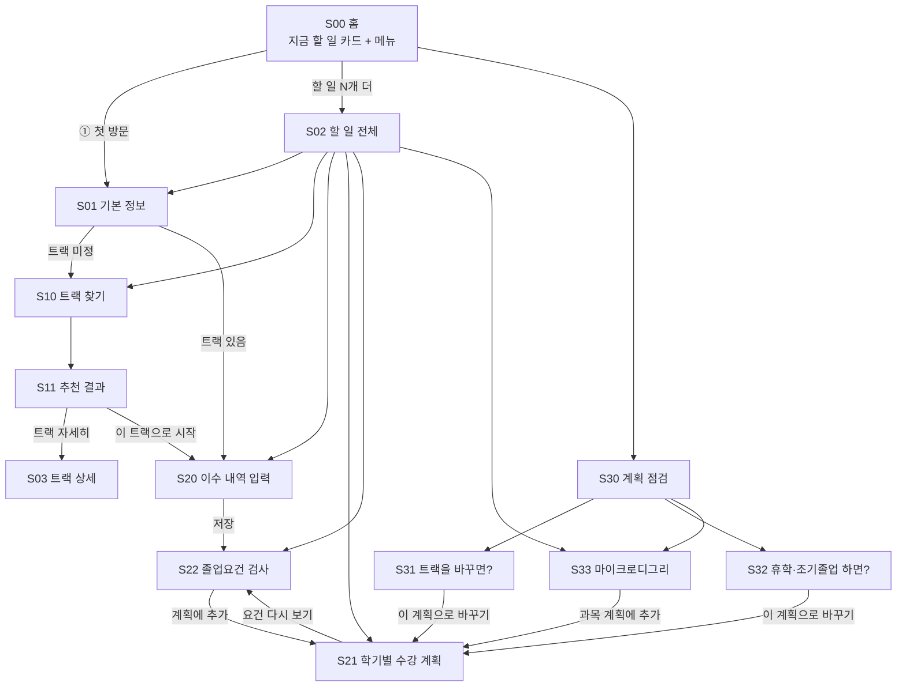

# 화면 구성 (초안 v1)

> 기준일 2026-11-22 · 결정: 임솔(기획)
> 근거: AGENTS.md 1장(찾다·짜다·지키다), `docs/tasks/ROADMAP.md`, `docs/DECISIONS.md`, T-002·T-009 지시서
> 이 문서는 화면을 **무엇을 보여 주고 무엇을 하게 할지**만 정한다. 색·크기 같은 디자인과 코드는 각 작업지시서에서 정한다.

---

## 1. 원칙 — 우리가 기존 도구와 다른 점

종정시·Forgrad는 **조회만 되고, 그래서 무엇을 해야 하는지는 알려 주지 않는다** (기획 판단). 길잡이는 모든 화면이 아래 두 가지를 함께 보여 준다.

1. **지금 상태**: 몇 학점이 채워졌는지, 무엇이 부족한지. 근거(출처 링크·기준일)를 붙인다.
2. **다음 행동**: 그 상태에서 학생이 바로 할 수 있는 일을 버튼 하나로 제시한다.

그 밖의 원칙
- 학교 규정·과목·학점은 전부 `data/rules` 에서 읽는다. 데이터에 없으면 **"아직 데이터가 없어요"** 라고 표시하고 추측하지 않는다. (AGENTS.md 4-1)
- AI는 '찾다'에서만 쓴다. 졸업요건 판정과 시뮬레이션은 규칙 엔진이 한다.
- 학생 입력은 이 기기(브라우저 localStorage)에만 저장한다. 학번·이름은 받지 않는다. (AGENTS.md 4-3)
- 학교 서비스처럼 익숙하게: 홈은 메뉴를 나열하는 목록형이다. 휴대폰 화면(폭 375px)을 기준으로 먼저 맞춘다.
- 화면 문구는 쉬운 말로 쓴다. 학사 용어(전기·전필·전선 등)는 처음 나올 때 풀어 쓴다.

## 2. 확정 사항 (2026-11-22, 임솔)

| # | 항목 | 결정 |
|---|---|---|
| 1 | 홈 메뉴 | 단계별 묶음: 찾다·짜다·지키다 제목 아래에 메뉴 나열 (종정시식 목록형) |
| 2 | 홈 맨 위 | 학생 상태에 따라 바뀌는 **'지금 할 일' 카드** 1장 |
| 3 | 카드에 보일 것 | 가장 급한 할 일 1개 + 버튼 1개 + "할 일 N개 더" |
| 4 | 할 일 우선순위 | 입력 순서(기본 정보 → 트랙 → 이수) 다음은 **졸업 위험 먼저** (4장 표) |
| 5 | 첫 방문 | 기본 정보 → (트랙 미정이면 트랙 찾기) → 이수 입력 |
| 6 | 이수 입력 | 전공: 내 트랙 교육과정 목록에서 체크 / 교양·비교과: 영역별 학점 숫자 |
| 7 | 졸업요건 검사 | 부족한 요건마다 **채우는 방법 + 행동 버튼** (예: 안 들은 과목 → [계획에 추가]) |
| 8 | 지키다 시뮬레이션 | 지금 계획과 비교 → **[이 계획으로 바꾸기]**. 바꾸기 전 계획은 자동 보관, 되돌리기 가능 |
| 9 | 메뉴 이름 | 묶음 제목은 '찾다·짜다·지키다', 메뉴 항목은 쉬운 업무 이름 (6장 S00) |
| 10 | 목록에 없는 과목 | **'기타 과목'** 으로 과목명·학점만 받는다. 전공 요건에는 세지 않고 **총 학점에만** 넣는다 (다른 전공·교직 과목을 들은 학생의 총 학점이 틀리지 않게) |
| 11 | 홈 메뉴 옆 상태 표시 | **첫 판에 넣는다.** 조회만 하는 기존 도구와 다르다는 점을 가장 잘 보여 주는 부분 |

---

## 3. 화면 목록

| ID | 화면 | 주소 | 묶음 | 만드는 작업 |
|---|---|---|---|---|
| S00 | 홈 | `/` | — | 새 작업 필요 (6장) |
| S01 | 기본 정보 | `/me` | 공통 | 새 작업 필요 |
| S02 | 할 일 전체 | `/todo` | 공통 | 새 작업 필요 |
| S03 | 트랙 상세 | `/tracks/[track_id]` | 공통 | 새 작업 필요 |
| S10 | 트랙 찾기 | `/find` | 찾다 | T-011 |
| S11 | 추천 결과 | `/find/result` | 찾다 | T-011, T-012 |
| S20 | 이수 내역 입력 | `/plan/taken` | 짜다 | T-006 (나누기 검토) |
| S21 | 학기별 수강 계획 | `/plan` | 짜다 | T-006 |
| S22 | 졸업요건 검사 | `/plan/check` | 짜다 | T-008 |
| S30 | 계획 점검 (지키다 메뉴) | `/guard` | 지키다 | T-016 |
| S31 | 트랙을 바꾸면? | `/guard/track-change` | 지키다 | T-013, T-016 |
| S32 | 휴학·조기졸업 하면? | `/guard/schedule` | 지키다 | T-014, T-016 |
| S33 | 마이크로디그리 | `/guard/micro-degree` | 지키다 | T-015, T-016 |

- 주소는 T-001에서 만든 `/find`, `/plan`, `/guard` 를 그대로 쓰고 그 아래에 붙인다.

## 4. '지금 할 일' 카드 규칙

위에서부터 검사해서 **처음 걸리는 하나**를 카드에 띄운다. 나머지 해당 항목 수는 "할 일 N개 더"로 보여 주고, 누르면 S02(할 일 전체)에서 같은 순서로 모두 보인다.

| 순서 | 조건 | 카드 문구 (예) | 버튼 → 화면 | 판단 근거 |
|---|---|---|---|---|
| ① | 기본 정보가 없다 | 처음 오셨네요. 입학년도와 트랙부터 알려 주세요 (1분) | [시작하기] → S01 | localStorage |
| ② | 트랙이 '아직 미정' | 어떤 트랙이 맞을지 희망 진로로 찾아봐요 | [트랙 찾기] → S10 | 기본 정보 |
| ③ | 이수 내역이 비어 있다 | 지금까지 들은 과목을 체크하면 졸업까지 남은 걸 알려 드려요 | [이수 과목 입력] → S20 | localStorage |
| ④ | **남은 학기에 다 넣어도 못 채우는 요건**이 있다 (졸업 위험) | 이대로면 ○○이 △학점 모자라요. 계획을 다시 짜거나 일정을 바꿔 봐요 | [계획 다시 짜기] → S21 (보조: [휴학·조기졸업 하면?] → S32) | 규칙 엔진 + **데이터 필요 (아래)** |
| ⑤ | 신청해야 인정되는 일이 있다 (`needs_application = true` 인 마이크로디그리 과목을 듣는 중·계획 중) | ○○ 마이크로디그리는 신청해야 인정돼요 | [신청 방법 보기] → S33 (출처 링크) | micro_degrees.csv |
| ⑥ | 부족한 요건이 있다 (남은 학기로 채울 수 있음) | 전공선택이 6학점 부족해요. 남은 학기에 나눠 넣으면 돼요 | [수강 계획에 추가하기] → S22의 해당 요건 | requirements.csv |
| ⑦ | 비학점 요건을 아직 확인하지 않았다 | 졸업 전에 직접 확인할 항목이 2개 있어요 | [확인하기] → S22의 비학점 칸 | requirements.csv (`type=비학점`) |
| ⑧ | 모두 충족 | 졸업요건을 모두 채웠어요. 다음 학기 계획만 점검해요 | [다음 학기 계획 보기] → S21 | — |

- 카드는 항상 **근거 한 줄**을 작게 붙인다. 예: "기준: 2026 졸업요건 (출처 · 2026-11-20 확인)"
- ④를 판단하려면 "한 학기에 들을 수 있는 최대 학점" 규정이 필요하다. **데이터 필요** (지금 CSV 5종에 없음). 데이터가 없으면 ④는 띄우지 않고 ⑥으로 처리한다. 카드에 "학기당 최대 학점 정보가 없어 졸업 위험은 아직 계산하지 않아요"를 작게 표시한다.
- ⑤는 신청 마감일 데이터가 없으므로 날짜로 급함을 판단하지 않는다.

## 5. 이동 흐름

**첫 방문 학생의 기본 흐름**: 홈 → S01 기본 정보 → (트랙 미정이면 S10 → S11 → "이 트랙으로 시작") → S20 이수 입력 → S22 졸업요건 검사 → 부족한 요건마다 [계획에 추가] → S21 학기별 계획

- 모든 화면 위쪽에 **[홈]** 이 있다. 홈으로 돌아오면 카드가 새 상태로 바뀐다.

---

## 6. 화면별 내용

각 화면은 **목적 / 보여 줄 것 / 다음 행동 / 비었을 때** 순서로 적는다.

### S00 홈 `/`
- **목적**: 지금 무엇을 해야 하는지 바로 알려 주고, 모든 메뉴로 가는 출발점
- **보여 줄 것** (위에서 아래로)
  1. 제목 "길잡이" + 한 줄 소개
  2. **지금 할 일 카드** (4장 규칙)
  3. 메뉴 목록 (단계별 묶음)
     - **찾다** — 진로에서 트랙까지
       - 희망 직무로 트랙 찾기 → S10 (직무 탭)
       - 채용공고로 트랙 찾기 → S10 (공고 탭)
     - **짜다** — 학기별 계획
       - 내 이수 내역 → S20
       - 학기별 수강 계획 → S21
       - 졸업요건 검사 → S22
     - **지키다** — 계획 점검
       - 트랙을 바꾸면? → S31
       - 휴학·조기졸업 하면? → S32
       - 마이크로디그리 → S33
  4. 아래쪽 작은 링크: 내 정보(S01) · 데이터 기준 안내(출처·기준일) · "입력한 내용은 이 기기에만 저장돼요"
- **메뉴 옆 상태 표시 (첫 판에 포함, 확정 11)**: 각 메뉴 오른쪽에 짧은 상태를 붙인다. 조회만 하는 목록이 아니라 '어디를 봐야 하는지'가 보이게 하기 위함이다.

  | 메뉴 | 상태 예 | 비었을 때 |
  |---|---|---|
  | 희망 직무·채용공고로 트랙 찾기 | "추천 3개 받음" | (표시 없음) |
  | 내 이수 내역 | "42학점 입력됨" | "아직 입력 전" |
  | 학기별 수강 계획 | "3학기 · 18과목" | "아직 계획 없음" |
  | 졸업요건 검사 | "2개 부족" / "모두 충족" | "이수 입력 후 확인" |
  | 트랙을 바꾸면? · 휴학·조기졸업 하면? | (표시 없음, 미리 보기 메뉴) | — |
  | 마이크로디그리 | "신청 필요 1개" / "진행 중 1개" | (표시 없음) |

  - 상태 문구는 '지금 할 일' 카드와 같은 규칙 엔진 결과에서 만든다. 화면마다 따로 계산하지 않는다.
- **비었을 때**: 카드는 ①, 메뉴 상태 표시는 없음

### S01 기본 정보 `/me`
- **목적**: 졸업요건과 교육과정을 고르는 데 필요한 최소 정보만 받기
- **입력**
  - 입학년도 (4자리. 졸업요건의 `applies_from`~`applies_until` 범위를 고르는 데 씀)
  - 주간·야간
  - 지금 트랙 (`tracks.csv` 목록에서 선택, 모집중지 트랙도 선택 가능) 또는 **"아직 정하지 않았어요"**
  - 지금 학년·학기 (예: 2학년 2학기 재학 중. 남은 학기를 계산하는 데 씀)
- **받지 않는 것**: 학번, 이름, 연락처
- **다음 행동**: [저장] → 트랙 미정이면 S10, 있으면 S20
- **그 밖**: 이 화면 아래에 **[이 기기에 저장된 내 정보 모두 지우기]** 를 둔다 (사용성 테스트 때 기기를 돌려쓰기 위함, ROADMAP 체크리스트)

### S02 할 일 전체 `/todo`
- **목적**: 카드에 다 못 띄운 할 일을 같은 우선순위로 모두 보여 주기
- **보여 줄 것**: 4장 표 순서대로 해당하는 할 일 목록. 항목마다 문구 1줄 + 버튼 1개 + 근거 1줄
- **비었을 때**: "지금 할 일이 없어요" + [다음 학기 계획 보기]

### S03 트랙 상세 `/tracks/[track_id]`
- **목적**: 추천·선택 전에 트랙을 확인
- **보여 줄 것** (전부 `data/rules`)
  - 트랙 이름·단과대학·주야간·운영 상태
  - 전공역량·관련 진로·관련 자격증 (`competencies.csv`)
  - 학년·학기별 교육과정 표: 전기·전필·전선, 과목명, 학점 (`courses.csv`)
  - 출처 링크·기준일
- **다음 행동**: [이 트랙으로 계획 시작] (S01의 트랙을 바꾸고 S20으로)
- **모집중지 트랙**: 위에 "지금은 새로 선택할 수 없는 트랙이에요"를 표시한다. 찾다 추천에는 나오지 않는다 (T-009).

### S10 트랙 찾기 `/find`
- **목적**: 희망 진로에서 맞는 트랙을 찾기 (AI)
- **입력** (탭 두 개)
  - 희망 직무: 직무 이름 + 관심 키워드(선택, 최대 5개)
  - 채용공고: 공고 붙여넣기 (최대 5,000자, 넘으면 앞부분만 분석한다고 미리 안내)
- **안내 문구 (입력창 아래)**: "개인정보(이름·연락처·학번)는 넣지 마세요. 들어 있으면 자동으로 가리고 분석해요"
- **다음 행동**: [트랙 추천받기] → S11
- **오류·한도**: T-009의 오류 문구를 그대로 쓴다 (AI 설정 안 됨 / 사용량 많음 / 추천 실패)

### S11 추천 결과 `/find/result`
- **목적**: 추천 트랙과 **근거**를 보여 주고 바로 계획으로 잇기
- **보여 줄 것** (최대 3개, T-009 응답 형식)
  - 트랙 이름, 적합도(높음·보통)
  - 추천 이유: 템플릿 문장. 예: `공고의 "대용량 데이터 처리" 부분이 이 트랙의 "빅데이터 처리" 역량과 맞아요`
  - 관련 과목 최대 5개 (과목명·학점·권장 학년, 데이터 기준)
  - 공고에서 찾은 역량 목록, 출처·기준일
- **다음 행동** (트랙마다)
  - **[이 트랙으로 계획 시작]** → S01 트랙 변경 후 S20 (T-012)
  - [트랙 자세히] → S03
- **비었을 때**: "입력하신 내용과 맞는 트랙을 찾지 못했어요. 직무를 조금 더 구체적으로 적어 보세요" + [다시 입력]
- **표시 규칙**: AI가 쓴 글자는 화면에 텍스트로만 보여 준다. 트랙명·과목명은 데이터에서 가져온다. (T-009)

### S20 이수 내역 입력 `/plan/taken`
- **목적**: 지금까지 들은 과목을 빠르게 입력
- **입력**
  - **전공**: 내 트랙 교육과정(`courses.csv`)을 학년·학기별로 펼쳐 놓고 **들은 과목 체크**. 과목마다 이수구분(전기·전필·전선)과 학점을 보여 준다.
  - **교양·비교과**: 영역별 **학점 숫자** 입력. 영역 목록은 `requirements.csv` 의 `type` 을 따른다. 지금은 `교양`, `비교과` 각 1칸이다.
  - **기타 과목** (확정 10): 목록에 없는 과목(다른 전공 과목, 교직 과목, 폐지 과목 등)은 [기타 과목 추가]로 **과목명과 학점만** 받는다.
    - 전공 요건(전기·전필·전선)에는 **세지 않고 총 학점에만** 더한다.
    - 화면에 "기타 과목은 총 학점에만 들어가요. 전공으로 인정되는지는 학과에 확인하세요"를 표시한다.
    - 과목명은 학생이 쓴 글자 그대로 텍스트로만 보여 준다. 학교 데이터와 대조하지 않는다.
- **보여 줄 것**: 입력하는 동안 아래에 합계가 바로 바뀐다 (전공·교양·기타·총 학점)
- **다음 행동**: [저장하고 졸업요건 보기] → S22
- **비었을 때**: 트랙이 없으면 "먼저 트랙을 정해 주세요" + [기본 정보] / [트랙 찾기]

### S21 학기별 수강 계획 `/plan`
- **목적**: 남은 학기에 무엇을 들을지 배치
- **보여 줄 것**
  - 지금 학기 다음부터 졸업 예정 학기까지 학기 칸 (예: 3-1, 3-2, 4-1, 4-2)
  - 칸마다 넣은 과목과 학기 학점 합계
  - 위쪽에 요약 한 줄: "계획대로 들으면 졸업요건 ○개 중 ○개 충족" → 누르면 S22
- **다음 행동**
  - 칸마다 [과목 추가]: 내 트랙에서 아직 안 들은 과목 목록(권장 학년·학기가 맞는 것 먼저)에서 고른다
  - 과목마다 [빼기]·[다른 학기로 옮기기]
  - [요건 다시 보기] → S22
- **지키다에서 넘어왔을 때**: 맨 위에 "트랙 변경 계획으로 바꿨어요 · [이전 계획으로 되돌리기]"를 표시한다

### S22 졸업요건 검사 `/plan/check`
- **목적**: 무엇이 부족한지와 **어떻게 채우는지**를 함께 보여 주기 (차별점의 중심 화면)
- **보여 줄 것**: 내 입학년도·트랙에 해당하는 요건(`requirements.csv`)을 하나씩 카드로
  - 요건 이름, `필요 / 이수 / 계획 포함` 학점, 상태(충족·부족·졸업 위험)
  - 근거: 출처 링크·기준일·비고(`note`)
- **다음 행동 (요건마다)**
  - **학점 요건이 부족할 때**: "채우는 방법"으로 내 트랙에서 아직 안 들은 해당 이수구분 과목을 보여 준다 (데이터에 있는 것만, 권장 학년 순). 과목마다 [계획에 추가] → S21
  - **교양·비교과가 부족할 때**: 과목 목록 데이터가 없으므로 "○학점 더 필요해요"와 출처 링크만 보여 준다. ('데이터 필요' 3)
  - **비학점 요건**: 조건 문장 + **[☐ 달성했어요]** 체크 + 출처 링크. 자동 판정하지 않는다. (DECISIONS 2026-11-22)
  - **졸업 위험(④)**: [계획 다시 짜기] → S21, [휴학·조기졸업 하면?] → S32
- **데이터가 없을 때**: 내 입학년도·트랙에 맞는 요건이 없으면 "내 입학년도의 졸업요건 데이터가 아직 없어요"를 표시한다. 다른 해의 요건으로 대신하지 않는다.

### S30 계획 점검 `/guard`
- **목적**: 계획을 바꾸기 전에 결과를 미리 보는 메뉴
- **보여 줄 것**: S31·S32·S33 세 메뉴 + 설명 한 줄씩 ("바꿔도 지금 계획은 그대로예요. 결과를 본 뒤에 바꿀지 정해요")

### S31 트랙을 바꾸면? `/guard/track-change`
- **입력**: 바꿀 트랙 선택 (운영 중인 트랙만)
- **보여 줄 것 (지금 / 바꾼 뒤 나란히)**
  - 졸업 예정 학기
  - 인정되는 학점 / 더 필요한 학점
  - 인정되지 않는 과목 목록
  - 근거 출처
- **다음 행동**: **[이 계획으로 바꾸기]** → 지금 계획을 자동 보관하고 S01 트랙·S21 계획을 바꾼다 / [취소]

### S32 휴학·조기졸업 하면? `/guard/schedule`
- **입력**: 휴학할 학기 선택 또는 조기졸업 희망 학기
- **보여 줄 것 (지금 / 바꾼 뒤)**: 졸업 예정 학기, 학기별 필요 학점, 조건 충족 여부와 근거
- **다음 행동**: [이 계획으로 바꾸기] → S21 / [취소]
- **데이터**: 휴학·조기졸업 규정은 아직 CSV에 없다 (ROADMAP '데이터 필요' 2). 데이터가 없으면 이 메뉴는 "준비 중 — 규정 데이터를 정리하고 있어요"로 둔다.

### S33 마이크로디그리 `/guard/micro-degree`
- **보여 줄 것**: 마이크로디그리별 진행률(이수·계획 과목 / 필요 과목), 유형(`type`), **신청 필요 여부** (`needs_application`)
- **다음 행동**
  - 남은 과목 [계획에 추가] → S21
  - 신청이 필요하면 [신청 방법 보기] (출처 링크) + "신청해야 인정돼요"

---

## 7. 이 기기에 저장하는 것 (localStorage)

| 저장 항목 | 쓰는 화면 |
|---|---|
| 기본 정보 (입학년도, 주야간, 트랙 또는 미정, 지금 학년·학기) | S01, 모든 화면 |
| 이수 내역 (체크한 전공 과목 코드, 교양·비교과 학점 숫자, 기타 과목의 과목명·학점) | S20, S22, 카드 |
| 학기별 계획 (학기 → 과목 코드 목록) | S21, S22, 지키다 |
| 비학점 요건 체크 | S22, 카드 |
| 보관한 이전 계획 1개 (지키다에서 바꾸기 전) | S21 되돌리기 |
| 마지막 찾다 결과 (선택) | S11 다시 보기 |

- 저장 형식·손상된 값 처리는 T-004에서 정한다. 학번·이름·공고 원문은 저장하지 않는다.

---

## 8. 데이터 필요 / 남은 결정

**데이터 필요**
1. **한 학기 최대 신청 학점** (카드 ④ 졸업 위험 판단). 지금 CSV 5종에 담을 곳이 없다. kyu0lee가 T-003 범위에서 규정을 확인하고 담을 열·파일을 제안한다 (T-003 6-2). 임솔이 정한다.
2. **휴학·조기졸업 규정** (S32). ROADMAP '데이터 필요' 2와 같다.
3. **교양·비교과 과목 또는 영역 목록** (S20·S22에서 "무엇을 들으면 채워지는지"를 보여 주려면 필요). ROADMAP '데이터 필요' 5와 같다. 그 전까지는 학점 숫자만 받는다.
4. **마이크로디그리 신청 방법 링크** (S33). `micro_degrees.csv` 의 `source` 로 충분한지 확인한다.

**남은 결정**: 없음. (메뉴 이름·기타 과목·상태 표시는 2026-11-22 확정 9~11)

---

## 9. ROADMAP과의 관계

- **이미 있는 작업에 맞춰야 할 것**
  - T-006(짜다 화면 ①)은 S20(이수 입력)과 S21(학기 계획)을 함께 맡고 있다. 지시서를 쓸 때 둘로 나눌지 본다.
  - T-008은 S22, T-011·T-012는 S10·S11, T-016은 S30~S33이다.
- **새로 넣은 작업** (ROADMAP '6. 공통 화면')
  - T-020: '지금 할 일' 규칙 엔진 (4장 우선순위 + 홈 상태 표시 문구, 순수 함수 + 테스트)
  - T-021: S00 홈 (카드 + 단계별 메뉴 + 메뉴 옆 상태 표시)
  - T-022: S01 기본 정보 + 이 기기 데이터 지우기
  - T-023: S02 할 일 전체
  - T-024: S03 트랙 상세
- **기존 작업에 더할 것**
  - T-004(저장소): 기타 과목(과목명·학점), 비학점 체크, 보관한 이전 계획 1개
  - T-005(학점 합계): 기타 과목은 총 학점에만 더함
- **주의**: T-001에서 만든 지금 홈(세 버튼)은 S00으로 바뀐다.
